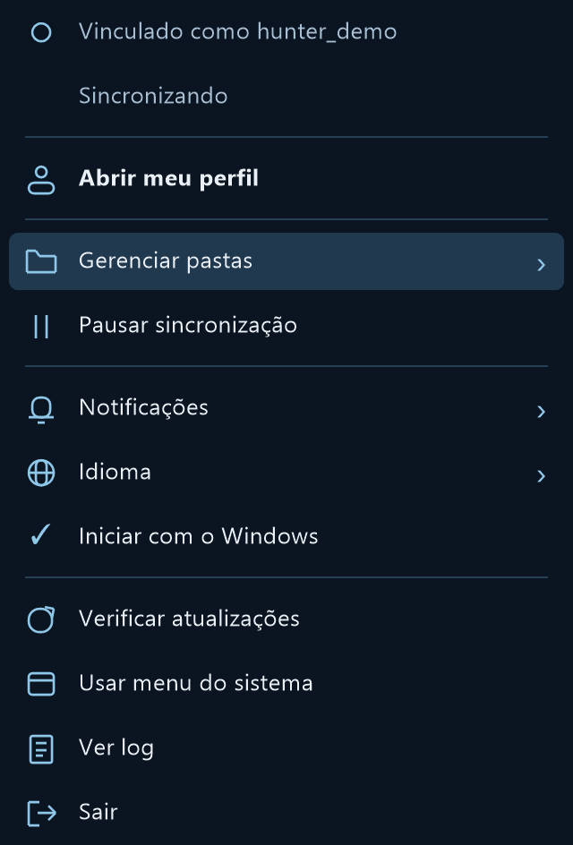
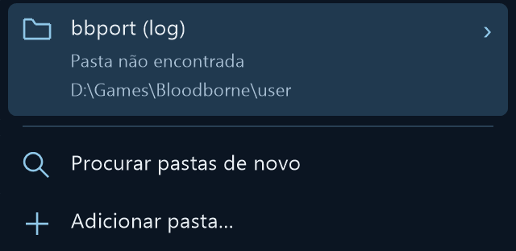

# Menu e pastas acompanhadas — beta.8

No ícone do Vigil perto do relógio, abra **Gerenciar pastas**. Cada pasta mostra os leitores
configurados, o caminho e o estado conhecido. Uma pasta ausente ou ilegível é identificada;
pausa e falta de vínculo não são apresentadas como acompanhamento ativo.

Abra o submenu da pasta e escolha **Parar de acompanhar**. A confirmação explica que apenas
a configuração muda: arquivos do jogo, saves, vínculo, conquistas e eventos pendentes ficam intactos.
Uma remoção deliberada é lembrada e não volta nas ofertas de detecção. Em **Pastas que você parou
de acompanhar**, escolha **Voltar a acompanhar** para restaurar os leitores anteriores. Adicionar
a pasta manualmente também é uma escolha explícita de reativação. **Agora não**, na detecção,
continua sendo uma recusa temporária, sem registrar uma remoção.

Quando vários leitores usam a mesma pasta, não somamos seus contadores como conquistas únicas.
A fila de eventos continua sendo enviada mesmo quando nenhuma pasta está configurada.

O menu mantém as funções da beta.7, inclusive vínculo, perfil, pausa, idioma, notificações,
início com o Windows, verificação de atualizações e log. **Usar menu do sistema** é uma preferência
persistente. Alto contraste e o sinal de leitor de tela do Windows também escolhem o menu padrão.

## Implementação e verificação

Usamos a API documentada [owner-drawn menus do Win32](https://learn.microsoft.com/en-us/windows/win32/menurc/using-menus#creating-owner-drawn-menu-items),
sem hooks de janelas do sistema. Windows controla teclado, submenus, Escape, clique fora, rolagem
e posicionamento na área útil. O ícone ancora a abertura, inclusive por teclado. O desenho usa
GDI+ existente, Inter quando instalada e Segoe UI/Arial como fallback. Sem animações.

Testes com dados sintéticos conferem a construção do menu real, textos/estados acessíveis pela
API nativa, medidas em 100/125/150/200%, seleção por teclado, submenu e Escape. A confirmação
visual usa o mesmo renderer, sem iniciar o agent do dono. Layouts físicos em múltiplos monitores,
clique fora com mouse físico e leitores de tela específicos não foram verificados manualmente.
O menu padrão é a alternativa para quem encontrar problemas de acessibilidade.

Os itens personalizados também expõem seus textos completos por `MSAAMENUINFO`, conforme o
protocolo de acessibilidade do Windows; a memória nativa permanece válida até o menu ser destruído.

Prévias do renderer (2x, estado fictício):

